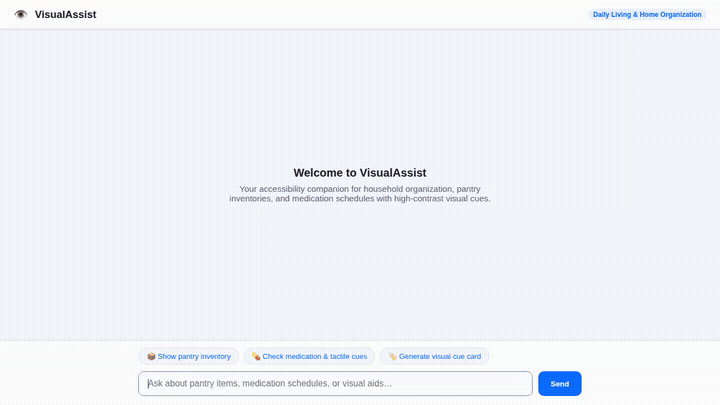

# 👁️ VisualAssist: Daily Living & Home Organization Assistant

VisualAssist is an accessibility-first agent built on Google Cloud's Agent Development Kit (ADK) and Gemini. It empowers low-vision and visually impaired individuals to independently organize, locate, and manage household items, pantry supplies, and medication schedules using structured inventory logging, tactile markers, and high-contrast visual aids.



---

## 🎯 What VisualAssist Does

VisualAssist provides conversational assistance for daily living with sensory orientation and safety checks:

- **Tactile & Location-Aware Item Lookup**: Searches household and pantry items by name, category, or tactile markers (e.g., rubber bands, textured tape, ridged stickers).
- **Medication Schedule & Dosage Inquiries**: Provides clear dosage frequency, storage guidance, and packaging tactile cues for prescribed medications.
- **High-Contrast Visual Aid Cards**: Dynamically generates high-contrast visual badges and tactile cue cards formatted with prominent titles, tactile descriptions, and locations.
- **Short Item Video Generation**: Uses Google's Omni model (`gemini-omni-flash-preview`) in the global region to generate 3-second close-up videos of items and packaging.
- **External FDA & Nutrition Grounding**: Queries live FDA packaging guides for medication warnings and USDA/OpenFoodFacts for ingredient/allergen verification.
- **Cross-Session Memory**: Automatically recalls user allergies, dietary restrictions, and household storage layouts across different conversation sessions.
- **Python Code Sandbox**: Executes Python calculations in an isolated Agent Engine sandbox to compute dosage schedules, intervals, and restock timelines.
- **Accessible Chat Frontend**: Provides a lightweight chat interface with high-contrast UI, custom dialogue layout, and quick example prompt chips.

---

## ☁️ Google Cloud & Architecture Services

VisualAssist is wired to the following Google Cloud and Agent Platform services:

| Component / Service | Implementation in Code |
| :--- | :--- |
| **Model** | `gemini-3.8-flash` via Google GenAI SDK |
| **Omni Video Model** | `gemini-omni-flash-preview` (Vertex AI Interactions API in `global` region) |
| **Memory Bank** | Vertex AI Memory Bank (`VertexAiMemoryBankService` with `PreloadMemoryTool` & `add_session_to_memory`) |
| **Database** | Google Cloud Firestore (manages `items` collection with tactile markers, locations, and dosage schedules) |
| **Object Storage** | Google Cloud Storage (public assets bucket hosting generated visual cue badges and video files) |
| **Code Execution** | Agent Engine Sandbox (`AgentEngineSandboxCodeExecutor`) |
| **UI Protocol** | A2UI v0.8 Basic Catalog (renders native card, column, row, text, and image components) |
| **Agent Runtime** | Agent Platform / Reasoning Engine deployment (`agents-cli` v1.4.0) |
| **Frontend Proxy** | FastAPI reverse proxy communicating with deployed agent via the Agent-to-Agent (A2A) protocol |

---

## 🛠️ Implemented Agent Tools

The agent in [`app/agent.py`](./app/agent.py) is equipped with the following active tools:

1. `list_items(category)`: Retrieves items from Firestore filtered by category (`pantry`, `medication`, `household`).
2. `search_item(query)`: Finds specific items in Firestore by name, category, or tactile marker description.
3. `add_or_update_item(...)`: Inserts or updates an item document with storage zone, shelf, and tactile marker details.
4. `get_current_time(timezone)`: Returns timezone-aware date and time for medication timing.
5. `lookup_medication_fda_guide(medication_name)`: Queries openFDA drug labels for warnings and dosage schedules.
6. `lookup_food_nutrition_and_ingredients(food_item)`: Checks food ingredients and allergen details via Open Food Facts.
7. `generate_item_visual_aid_card_image(item_name, tactile_marker, location)`: Generates high-contrast visual aid cards using Pillow, uploads them to Google Cloud Storage, and returns public HTTPS URLs.
8. `generate_item_video(item_name, description, tool_context)`: Generates short 3-second item videos via `gemini-omni-flash-preview`, saves the artifact to the Playground session with `tool_context.save_artifact`, and uploads the video bytes to Google Cloud Storage.
9. `PreloadMemoryTool()`: Reads long-term user facts and allergies from Vertex AI Memory Bank.

*(Note: Real-time camera optical character recognition from mobile video streams was outlined in initial planning and is marked as **planned, not yet implemented**).*

---

## 🚀 Running Locally

### Prerequisites
- Python 3.10+
- Google Cloud CLI (`gcloud`) authenticated to your Google Cloud project:
  ```bash
  gcloud auth login
  gcloud auth application-default login
  gcloud config set project YOUR_PROJECT_ID
  ```

### 1. Run the Agent Locally (ADK Web)
Install agent dependencies and launch the ADK development playground:
```bash
cd visual-assist
python3 -m venv .venv
source .venv/bin/activate
pip install -r requirements.txt
adk web
```
The ADK playground opens with the conversation interface, tool logs, and the Artifacts panel.

### 2. Run the Custom Frontend Locally
In a separate terminal, start the FastAPI chat proxy and web interface:
```bash
cd visual-assist/frontend
pip install -r requirements.txt
export AGENT_ENGINE_RESOURCE_NAME="projects/<PROJECT_NUMBER>/locations/<REGION>/reasoningEngines/<ENGINE_ID>"
export AGENT_DIRECTORY="app"
export PORT="8080"
python3 main.py
```
Open your browser to the local port displayed in the console (default `8080`) to interact with the branded VisualAssist dialogue layout.

---

## 📦 Project Structure

```text
visual-assist/
├── app/
│   ├── agent.py              # Root ADK agent configuration & tool wiring
│   ├── inventory_tools.py    # Firestore inventory & tactile marker tools
│   ├── image_tools.py        # High-contrast visual aid card generation & GCS upload
│   ├── video_tools.py        # Omni flash video generation, artifact saving & GCS upload
│   ├── fda_tools.py          # openFDA drug guidance tool
│   ├── nutrition_tools.py    # Open Food Facts nutrition & allergen lookup
│   ├── a2ui_utils.py         # A2UI model callback & component formatting
│   ├── seed_firestore.py     # Initial seed dataset for household items & medications
│   └── instruction.txt       # Pre-rendered A2UI system instruction fallback
├── frontend/
│   ├── main.py               # FastAPI proxy handling A2A protocol communication
│   ├── Dockerfile            # Container build specification for Cloud Run deployment
│   ├── static/
│   │   └── index.html        # Custom high-contrast dialogue layout & A2UI renderer
│   └── requirements.txt      # Frontend proxy dependencies
├── agents-cli-manifest.yaml  # Deployment manifest for Google Agent Platform
├── demo.gif                  # Recorded looping demo walkthrough
└── requirements.txt          # Agent & ADK dependencies
```
